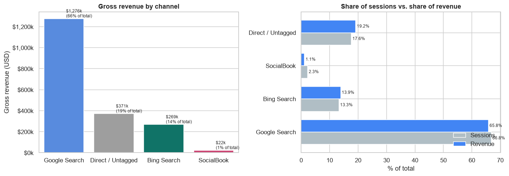
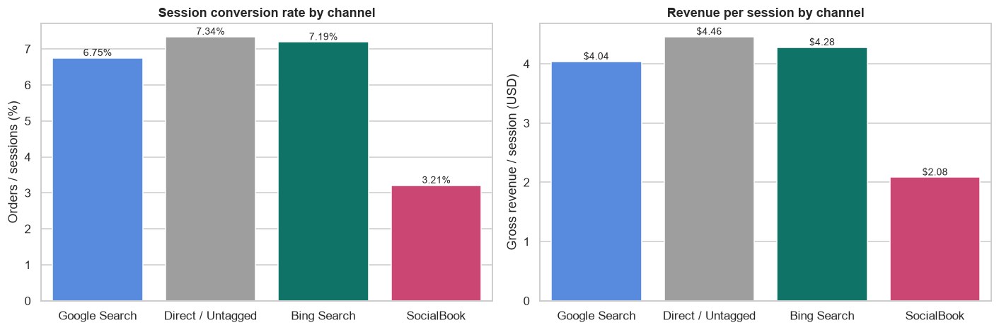
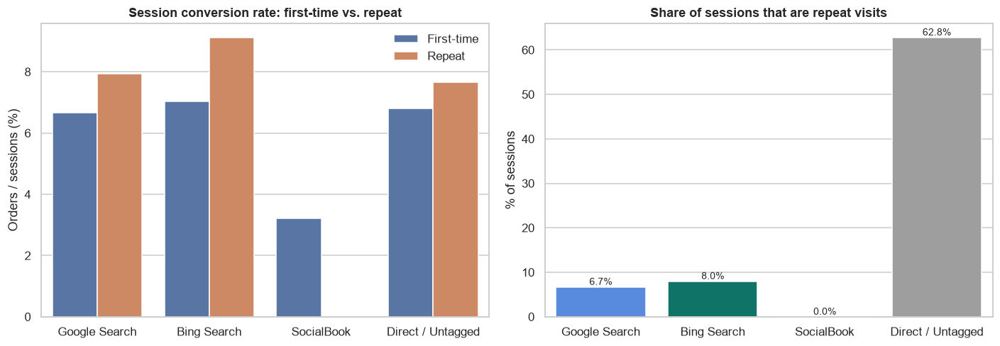
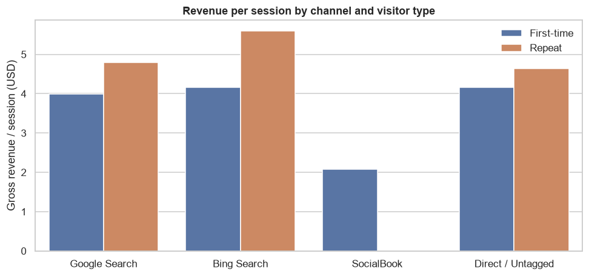
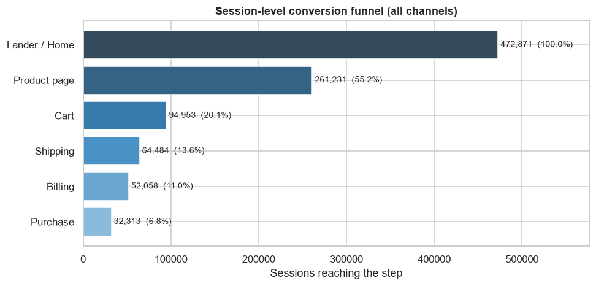
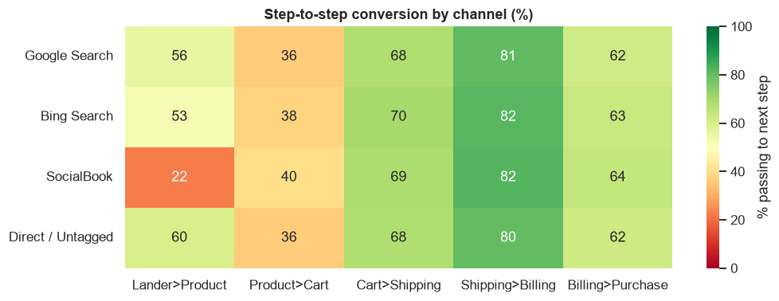
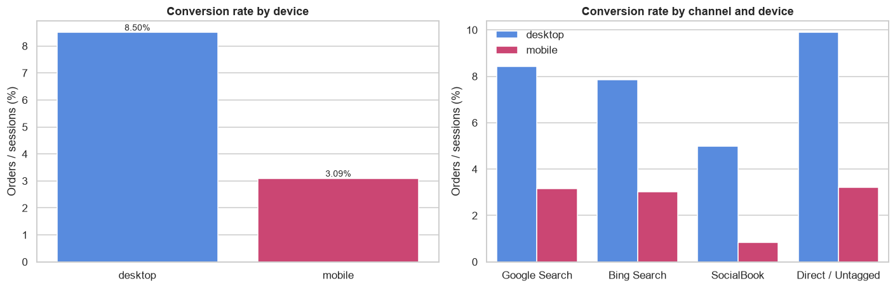
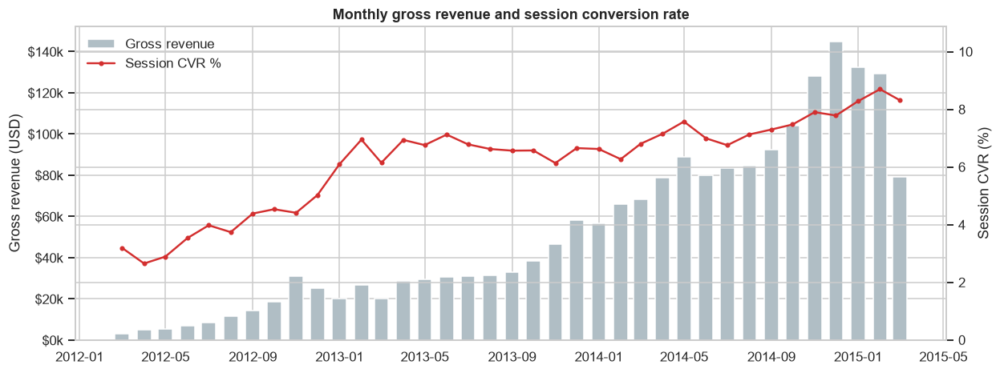

# Maven Fuzzy Factory — Channel Sales & Visitor Conversion Analytics

**An end-to-end analytics project: which marketing channels drive sales, and do first-time vs. repeat visitors convert differently by channel?**

Built with **Python (pandas)** for analysis, **PostgreSQL** for the warehouse-and-SQL layer, and **Power BI** for the interactive dashboard — using a three-year clickstream dataset for a *fictional* online toy retailer (Mar 2012 – Mar 2015).

---

## The business questions

| #      | Question                                                          | Decision it supports                                                          |
| ------ | ----------------------------------------------------------------- | ----------------------------------------------------------------------------- |
| **Q1** | Which channels drive sales?                                       | Where to concentrate acquisition budget                                       |
| **Q2** | Do first-time vs. repeat visitors convert differently by channel? | Whether a channel acquires *new demand* or simply *harvests returning demand* |

## Headline findings

**Dataset:** 472,871 sessions · 32,313 orders · **$1,938,509.75** 

 gross revenue · $1,853,171.06 net of refunds · 4 products.

**Q1 — Google Search drives the business; SocialBook wastes budget.**

| Channel           | Sessions | Orders | Session CVR | Gross revenue | % of revenue | Rev / session |
| ----------------- | --------:| ------:| -----------:| -------------:| ------------:| -------------:|
| Google Search     | 316,035  | 21,333 | 6.75%       | $1,276,145    | **65.8%**    | $4.04         |
| Direct / Untagged | 83,328   | 6,118  | **7.34%**   | $371,433      | 19.2%        | **$4.46**     |
| Bing Search       | 62,823   | 4,519  | 7.19%       | $268,673      | 13.9%        | $4.28         |
| SocialBook        | 10,685   | 343    | **3.21%**   | $22,259       | **1.1%**     | $2.08         |

**Q2 — Repeat visitors convert higher in *every* channel that has them, but channels differ enormously in how much repeat traffic they carry.**

| Channel           | First-time CVR | Repeat CVR           | Lift            | Repeat-session mix |
| ----------------- | --------------:| --------------------:| ---------------:| ------------------:|
| Bing Search       | 7.03%          | **9.12%**            | +2.10 pp (+30%) | 8.0%               |
| Google Search     | 6.66%          | **7.94%**            | +1.27 pp (+19%) | 6.7%               |
| Direct / Untagged | 6.81%          | **7.66%**            | +0.85 pp (+13%) | **62.8%**          |
| SocialBook        | 3.21%          | *no repeat sessions* | —               | 0.0%               |

**So the two questions connect:** a channel's headline conversion rate partly reflects *how much returning traffic it carries*. Google and Bing are genuine **acquisition** channels; direct/untagged is mostly **retention** traffic, so its high CVR should not be mistaken for media efficiency.

### Recommendations

1. **Fix or cut SocialBook** — 3.21% CVR, 1.1% of revenue, zero returning base, worst funnel entry (22% reach a product page vs ~50–60% elsewhere).
2. **Invest in mobile** — 30.8% of sessions but 3.09% CVR vs desktop's 8.50% (a 2.7× gap in *every* channel). Largest single upside.
3. **Treat direct/untagged as brand health, not a media channel** (62.8% repeat traffic).
4. **Scale Bing** — near-direct efficiency ($4.28/session) at a fraction of Google's volume.
5. **Fix the lander → product-page leak** (44.8% of sessions drop there) and the billing → purchase step.
6. **De-risk product concentration** — one product is 62.5% of revenue.

---

## Figures

|                                                                  |                                                                                 |
| ---------------------------------------------------------------- | ------------------------------------------------------------------------------- |
|      |  |
|  |                |
|                           |                    |
|                           |                            |

[Power BI Dashboard PDF](https://github.com/neuro59/maven-fuzzy-factory/blob/main/powerbi/dashboard-pdf.pdf)


---

## Repository structure

```
.
├── notebook/
│   └── maven_fuzzy_factory_analysis.ipynb   # main analysis (executed, with narrative + charts)
├── sql/
│   ├── 01_schema.sql                        # DDL, indexes, and two reporting views
│   ├── 02_load_data.sql                     # \copy bulk load
│   ├── 03_channel_sales.sql                 # Q1
│   ├── 04_new_vs_repeat.sql                 # Q2
│   └── 05_extended_analytics.sql            # funnel, device, trend, refunds, products
├── scripts/
│   └── load_to_postgres.py                  # creates DB + loads all six CSVs
├── powerbi/
│   ├── dashboard.pbix                       # Power BI dashboard
│   ├── dashboard-pdf.pdf                    # PDF of Power BI dashboard
│   ├── theme_maven_fuzzy.json               # report theme (channel colour palette)
│   └── data/                                # star-schema tables (fact_* + dim_*)
├── docs/figures/                            # charts exported from the notebook
├── maven-fuzzy-factory/                     # raw source CSVs (not committed — see Data)
├── requirements.txt
└── .env.example
```

---

## Tech stack & what it demonstrates

| Layer       | Tools                                               | Skills shown                                                                                              |
| ----------- | --------------------------------------------------- | --------------------------------------------------------------------------------------------------------- |
| Analysis    | Python, pandas, NumPy, matplotlib, seaborn          | data QA, metric design, EDA, funnel analysis, statistical framing, clear visual storytelling              |
| Warehouse   | PostgreSQL 18, SQL                                  | schema design, primary/foreign keys, `COPY` bulk load, `GROUP BY … FILTER`, window functions, CTEs, views |
| BI          | Power BI                                            | star-schema data model, DAX measures, interactive multi-page dashboard, drill-through                     |
| Engineering | psycopg2, SQLAlchemy, python-dotenv, nbconvert, Git | reproducible ETL, secrets handling, notebook automation                                                   |

**Analytical rigour:** a 15-check data-quality gate runs before any metric is computed, and **every headline figure is independently recomputed in SQL and reconciles exactly** to the pandas result (4/4 channels).

---

## Reproducing the project

### 1. Data

The raw CSVs live in `maven-fuzzy-factory/` and are **not committed** (≈100 MB, and they are third-party practice data from **Maven Analytics**). Download the *Maven Fuzzy Factory* practice dataset and drop the six CSVs plus the data dictionary into `maven-fuzzy-factory/`:

```
maven-fuzzy-factory/orders.csv, order_items.csv, order_item_refunds.csv,
                     products.csv, website_sessions.csv, website_pageviews.csv,
                     maven_fuzzy_factory_data_dictionary.csv
```

### 2. Python environment

```bash
python -m venv .venv && . .venv/Scripts/activate   # Windows
pip install -r requirements.txt
```

### 3. PostgreSQL

```bash
cp .env.example .env        # then set PGPASSWORD to your local postgres password
python scripts/load_to_postgres.py
```

This creates the `maven_fuzzy_factory` database, applies `sql/01_schema.sql`, and bulk-loads all six tables.
Run the analyses directly in SQL any time:

```bash
psql -U postgres -d maven_fuzzy_factory -f sql/03_channel_sales.sql
psql -U postgres -d maven_fuzzy_factory -f sql/04_new_vs_repeat.sql
psql -U postgres -d maven_fuzzy_factory -f sql/05_extended_analytics.sql
```

### 4. Notebook

```bash
jupyter lab notebook/maven_fuzzy_factory_analysis.ipynb
```

The notebook runs top-to-bottom. The PostgreSQL section degrades gracefully if no database is available.

# 

---

## Method notes & limitations

* **Attribution is last-touch at the session level.** One order per session makes this clean, but earlier touchpoints are ignored.
* **Untagged traffic is labelled, not dropped.** 83,328 sessions (17.6%) have no `utm_source`; keeping them visible as *"Direct / Untagged"* avoids silently inflating other channels' CVR.
* **The raw files encode missing values as the literal text `NULL`.** The loader maps these to true SQL NULLs
  (`COPY … NULL 'NULL'`) so PostgreSQL and pandas agree; this is documented in the notebook's QA section.
* **No cost data.** Channels can be ranked by revenue and margin, but not by true profit (ROAS/CAC).
* **`is_repeat_session` is session-level**, so a first-time session on a returning user's *second* visit is still flagged repeat — directionally correct, but a user-level cohort model would sharpen it.

---

## Licence / data credit

Analysis code and documentation: free to reuse. The dataset is the *Maven Fuzzy Factory* practice dataset published by **Maven Analytics** and is subject to their terms — it represents a fictional company.
